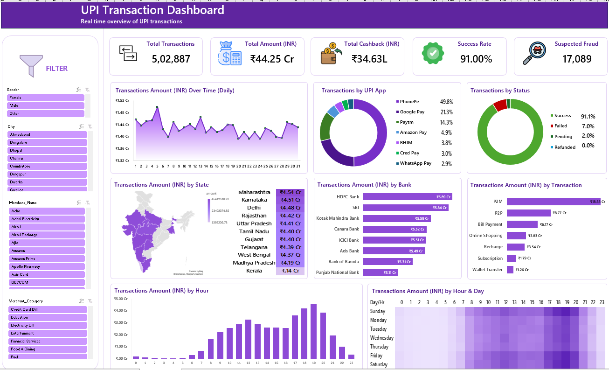

# UPI Transaction Analysis in Excel

A guided Excel portfolio project exploring UPI transaction data with PivotTables, charts and interactive slicers.

Built by following the [UPI Analysis Dashboard tutorial](https://www.youtube.com/watch?v=NtZTxn0xu7E) from [Data Tutorials](https://www.youtube.com/@datatutorials1). The tutorial, dataset and dashboard design guidance are credited to the channel. This repository documents my hands-on implementation and Excel practice.

## Project overview

What drives UPI payment activity, when do transactions peak, and how do payment outcomes vary? This interactive Excel dashboard brings these questions into one view across all UPI apps represented in the dataset.

It combines transaction counts, payment value, cashback, success rate and suspected-fraud indicators with daily trends, state-level comparisons, bank performance and hourly activity. Slicers let viewers explore patterns by gender, city, merchant and merchant category, connecting headline metrics with the segments behind them.

## Dashboard preview

## Tools and features## Tools and features

- Microsoft Excel
- PivotTables and charts
- Slicers for city, gender, merchant category and merchant name
- Transaction attributes covering payment amounts, cashback, status, failure reasons and risk indicators

## Data covered

The source worksheet, `raw_data_upi`, includes transaction date and time, UPI app, age group, gender, state, city, merchant category, payment mode, bank, amount in INR, cashback, transaction fee, status and risk indicators.

## Download the project files

[Download the Excel workbook from the latest release](https://github.com/alston2375/upi-transaction-analysis-excel/releases/latest)

1. Open the latest release and expand **Assets**.
2. Download `UPI_Transaction_Analysis.xlsx` for the analysis and dashboard.
3. Download `phonepay_raw_data.xlsx` for the original input dataset.
4. The automatically generated source-code ZIP does not contain these Excel attachments.
5. Open the files in desktop Microsoft Excel.
6. Explore the analysis sheets and use the available slicers to filter the views.

The full workbook is approximately 100 MB and is provided as a release attachment because it exceeds GitHub's browser limit for individual repository-file uploads.

## Dataset source and tutorial credit

- Tutorial: [Excel Dashboard Project — Build a Professional UPI Analysis Dashboard (2026)](https://www.youtube.com/watch?v=NtZTxn0xu7E)
- Channel: [Data Tutorials](https://www.youtube.com/@datatutorials1)
- Dataset: [Original download folder linked in the video description](https://drive.google.com/drive/folders/1SxSmd7fFdMOBzcyyZHZmId0gAZg-atI6?usp=sharing)

The input workbook is `phonepay_raw_data.xlsx`, with a source worksheet named `data`. The dataset was obtained from the tutorial resources. It has not been independently verified as real or synthetic, and it is not presented here as official PhonePe data.

The video description provides a download link but does not state explicit redistribution terms. This private repository is being reviewed before public sharing.

## Scope

The project explores transaction behaviour across all UPI apps included in the supplied dataset, covering payment volumes and values, transaction status, cashback, banks, states, transaction types and time-based patterns. It demonstrates Excel skills in summarising transaction data, building PivotTables and charts, designing KPI cards and connecting interactive slicers to a dashboard.

The analysis describes the supplied dataset and its selected filters; it does not represent the entire UPI market or a live transaction feed. Suspected-fraud figures reflect the dataset's flags and should not be interpreted as confirmed fraud.

Developed as a guided learning and portfolio project using Data Tutorials resources, with no affiliation to the payment providers shown.
